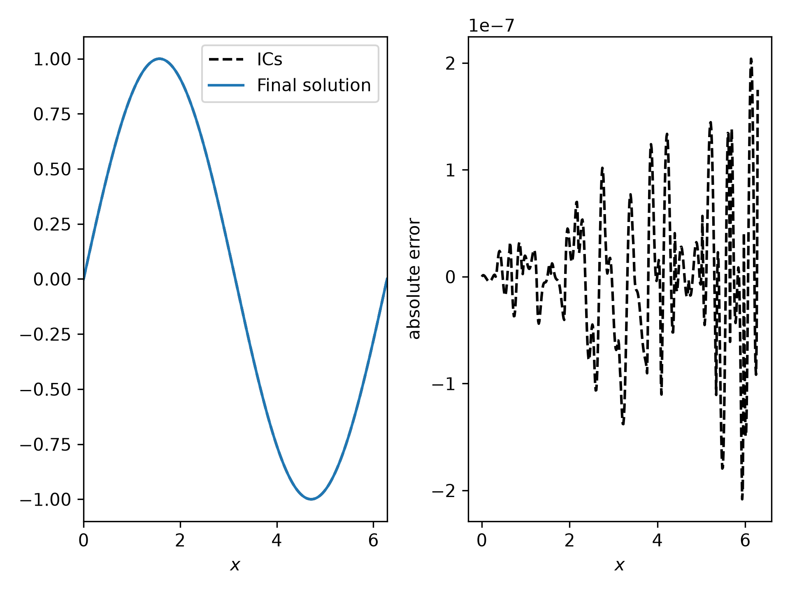

# Method of manufactured solutions for the scalar

## The method of manufactured solutions

The MMS is a verification technique based on the following. Consider some
equation $L(s) = 0$. We come up with some desired analytical solution $\hat
s(x,t)$, and  then analytically compute $\hat f = L(\hat s)$. If we now set
$\hat f$ as the source term: $L(s) = \hat f$, we expect the solution to follow
$\hat s(x, t)$.
Initial conditions are obtained as $\hat s(x, 0)$ and boundary conditions should
be selected to be compatible with the behaviour of $\hat s$.

## The case

Here we provide a very simple example, where $\hat s(x, t) = \sin(x)$ is used
for the scalar advection-diffusion equation. The domain has 20 elements across
$x$, and a single element across $y$ and $z$, which are periodic, to mimic a 1D
case. The idea is to make this example more interesting later. An additional
purpose is to provide a test case for scalar source terms.

The advecting velocity is set to $u = 1$ in $x$. Neko solves the scalar equation
in the form

$$
\rho c_p \left( \frac{\partial s}{\partial t} + \mathbf{u} \cdot \nabla s
\right) = \nabla \cdot (\lambda \nabla s) + \rho c_p f,
$$

so the source term is easily obtained as
$\hat f = u \cos(x) + \lambda \sin(x) / (\rho c_p)$.
Here, we set $\rho = c_p = u = 1$, and $\lambda = 0.01$.

## Case setup
To keep the advecting velocity constant, we enable `freeze` for the `fluid`. The
initial velocity distribution is set in the user file, and similarly for the
scalar.

The source term is split into two components for testing purposes. The user
source term is used to set the source to $\hat f - 1$ and a constant source term
is additionally added, equal to $1$. Therefore, the sum is equal to $\hat f$.

To analyse the results, the script `plot.py` uses pySEMTools to interpolate the
final scalar onto a line along $x$, plots it against the initial condition, and
prints the largest absolute error.

The mesh is generated with `genmeshbox` on the unit cube, and the user file
stretches it to $2\pi$ in $x$ and $y$. The $x$ boundaries are not periodic: the
scalar has a Dirichlet condition at $x = 0$ and a Neumann condition at
$x = 2\pi$, both matching $\hat s$.

The script `run.sh` can be used to run the study. We suggest inspecting the
script and the case file and modifying them to your liking.

## Expected results
The following curves will be obtained with the settings in the `run.sh` script.
One can see that the solution in the end is the same as the initial conditions,
which is expected based on our form of $\hat s$.

